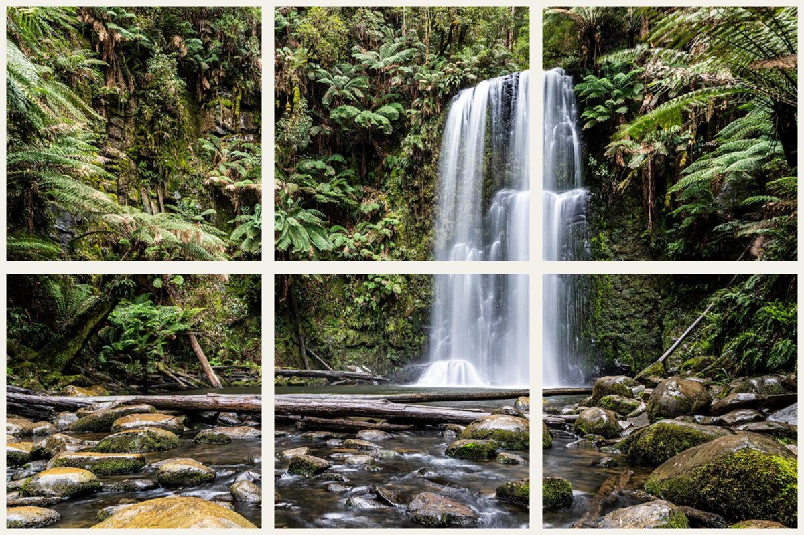
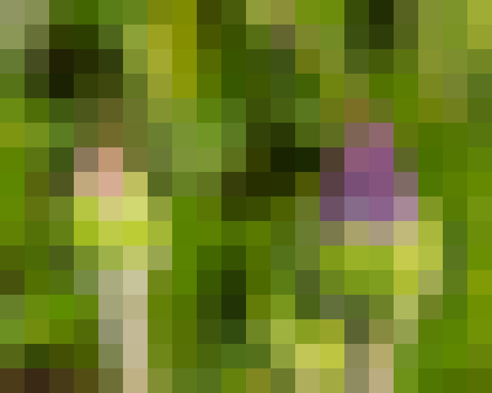

# MC-cli : trois commandes

### split

Découpe une image en une grille de tuiles, nommées <code>&lt;ligne&gt;_&lt;col&gt;_tile.bmp</code>.

`mc-cli split forest.bmp tiles/ -r 2 -c 3`

forest.bmp

→

6 tuiles 320×320

### merge

Recolle des images : grille lue dans les noms, ou en ligne, colonne, grille <code>-r -c</code>, ou en boucle <code>-R</code>.

`mc-cli merge 0_0_tile.bmp 1_2_tile.bmp -R 4 -o strip.bmp`

2 tuiles

→

A B A B · 1280×320

### mosaic

Remplit chaque case de la grille avec la couleur moyenne de ses pixels.

`mc-cli mosaic flowers.bmp -r 16 -c 20 -o mosaic.bmp`

flowers.bmp

→

16×20 cases

---

## Comment on a travaillé

Issue→
Branche→
PR vers <code>dev</code>→
Relecture de l'autre→
Merge→
<code>main</code> au rendu

### Issues

Chaque tâche ou bug devient une issue avec une liste de cases à cocher. On voit ce qui reste et qui fait quoi.

### Pull requests

24 PR vers <code>dev</code>, chacune relue par l'autre avant le merge. Commits au format Conventional Commits.

### Tests

79 tests JUnit 5 sur de petites images connues pixel par pixel. <code>./mvnw test</code> doit passer avant chaque merge.

### IA

Claude Code et Gemini : messages git, débogage, une partie du code, explications. Tout relu, testé et validé en PR.

